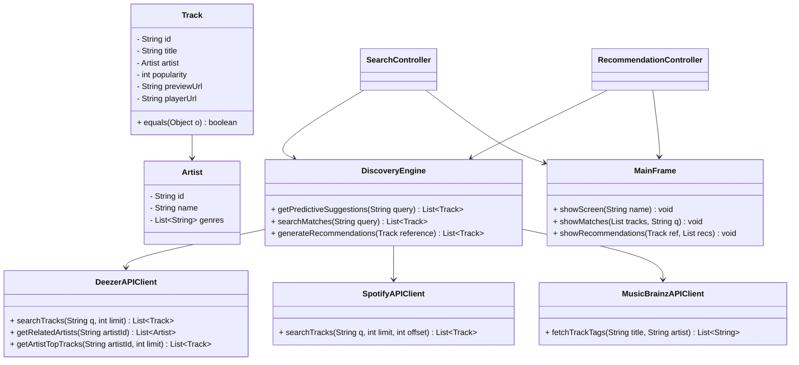

# AUDY Project Documentation Index

Welcome to the comprehensive technical documentation for **AUDY**, an advanced music discovery desktop application developed for the **Object-Oriented Programming** course at the **Autonomous University of Yucatán (UADY)**.

---

## 1. Final Delivery Technical Documentation (Tasks F1 – F12)

All official deliverables for the Third & Final Delivery are consolidated inside the dedicated [`final-delivery/`](final-delivery/README.md) directory, written in **100% technical English**:

| Task ID | Document Link | Technical Summary |
|---|---|---|
| **F1** | [Final Requirements](final-delivery/F1-final-requirements.md) | Formal specifications for 11 RF and 5 RNF, quantitative network bounds, and latency limits. |
| **F2** | [API Connections & Justification](final-delivery/F2-api-connections.md) | Multi-API integration (Deezer, Spotify, MusicBrainz), Spotify role explanation, and technical justification. |
| **F3** | [Recommendation Engine](final-delivery/F3-recommendation-engine.md) | 100% dynamic cloud collaborative graph, randomized peer sampling, and adaptive popularity thresholds (RF-07). |
| **F5** | [MVC Architecture & User Journey](final-delivery/F5-mvc-architecture.md) | Model-View-Controller layer responsibilities, user navigation flows, and cloud persistence («DB*») clarification. |
| **F6** | [UML Class Diagram & Evolution](final-delivery/F6-uml-and-design-evolution.md) | Complete final system UML class diagram (Mermaid) and 3-sprint architectural evolution. |
| **F7** | [Updated Use Cases](final-delivery/F7-use-cases.md) | Formal use case specifications (CU-01, CU-02, CU-03) with main, alternative, and exception flows. |
| **F8** | [Requirements Verification](final-delivery/F8-requirements-verification.md) | Comprehensive traceability matrix and execution results for all 37 automated tests (**37/37 PASS**). |
| **F9** | [Sprint 3 Log](final-delivery/F9-sprint3-log.md) | Weekly management log, team ceremonies, roadblocks resolved (Spotify dev restrictions, Swing focus grabs). |
| **F10** | [Individual Contribution](final-delivery/F10-individual-contribution.md) | Multi-dimensional weighted formula and individual contribution percentages strictly summing 100.0%. |
| **F11** | [Main Repository README](../README.md) | Clean repository organization, zero-config quick start, build instructions, and verification guide. |
| **F12** | [Final Presentation & Demo Guide](final-delivery/F12-presentation-script.md) | Complete 10-minute technical English script, live demo walkthrough, and course improvement proposals. |

---

## 2. Historical Design & Early Artifacts

- [Interaction Flow and Interface Design](diseno/README.md): Original iPad sketches, Figma interaction flowcharts, and high-fidelity mockups.
- [Initial Use Case Diagrams](casos-de-uso/README.md): Conceptual use case diagram and preliminary flows.

---

## 3. System Architecture & Complete UML Diagram



---

## 4. Quick Compilation and Execution

```powershell
# Compile all Java sources
$sources = Get-ChildItem -Path "src/main/java" -Recurse -Filter "*.java" | ForEach-Object { $_.FullName }
javac -d out -sourcepath src/main/java $sources

# Launch the AUDY application (Zero configuration needed)
java -cp out com.audy.Main

# Run the automated verification test suite (37 tests)
java -cp out com.audy.test.RequirementsVerification
```
