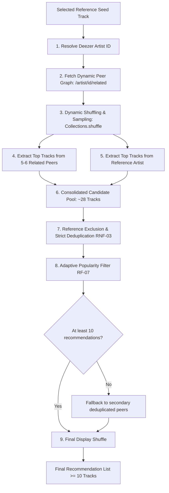

# F3 · AUDY Recommendation Engine Specification

This document details the architecture, business logic, algorithmic parameters, and mathematical thresholds implemented in [`com.audy.services.DiscoveryEngine`](file:///c:/MEXIQUE/POO/MusicOrientedProgramming_Uady/src/main/java/com/audy/services/DiscoveryEngine.java), satisfying requirements **RF-05**, **RF-06**, **RF-07**, **RF-08**, **RNF-03**, and **RNF-04**.

---

## 1. Core Principle: 100% Dynamic Knowledge Graph

By explicit university design directive, the AUDY recommendation engine **contains zero hardcoded knowledge, static artist dictionaries, or hardcoded genre clusters**.

All relational music discovery is computed dynamically via **Deezer's Cloud Web API** (`GET /artist/{id}/related`), which exposes an authentic similarity graph calculated through **collaborative filtering** and machine-learning analysis across millions of real listening sessions.

---

## 2. Recommendation Algorithm Workflow



### Step 1: Artist Identifier Resolution
If the reference track originated from external text search or lacks a numeric Deezer artist identifier, `DiscoveryEngine` invokes `deezerApi.resolveArtistId(artistName)` to guarantee that subsequent relational queries target an authenticated cloud entity.

### Step 2: Dynamic Peer Graph Retrieval
The engine queries `deezerApi.getRelatedArtists(artistId)`, retrieving up to 20 dynamically related artists from Deezer's collaborative listening graph (e.g., for *Nirvana*, Deezer dynamically returns *The Smashing Pumpkins, Foo Fighters, Pearl Jam, Soundgarden, Rage Against the Machine, Red Hot Chili Peppers, The Offspring, Alice in Chains*).

### Step 3: Freshness & Diversity Mechanism (Non-Repetitive Searches)
To prevent identical, repetitive recommendation sets across multiple searches of the same track, the engine executes randomized peer sampling:
```java
Collections.shuffle(relatedPeers);
List<Artist> selectedPeers = relatedPeers.subList(0, Math.min(6, relatedPeers.size()));
```
By shuffling the 20 related peers and selecting an arbitrary subset of 5 to 6 artists, querying the same seed today, tomorrow, or in five minutes surfaces distinct facets of the musical scene.

### Step 4: Multi-Source Candidate Extraction
For each selected peer, the engine retrieves their top 4 tracks (`GET /artist/{id}/top?limit=4`). In parallel, it retrieves the top 5 tracks of the reference artist itself to facilitate deep catalog exploration. This produces an initial candidate pool of 24 to 30 songs.

### Step 5: Strict Reference Exclusion & Deduplication (RNF-03)
Candidates are accumulated into a `LinkedHashSet<Track>` using strict equality:
1. `candidate.equals(referenceTrack)`: Matches on both track ID and case-insensitive `(title + artist)`.
2. Any duplicated version or live remaster is filtered out immediately.

### Step 6: Adaptive Popularity Filter (RF-07)
Rather than applying arbitrary static filters, AUDY dynamically calculates popularity bounds as a function of the reference track's popularity ($P \in [0, 100]$):

| Reference Category | Seed Condition | Lower Bound ($\text{minPop}$) | Upper Bound ($\text{maxPop}$) | Musical Discovery Objective |
|---|---|:---:|:---:|---|
| **Mainstream / Global Hit** | $P > 70$ | $30$ | $99$ | Balances top-tier peers while filtering out repetitive isolated mega-hits. |
| **Mid-Tier / Standard** | $30 \le P \le 70$ | $\max(10, P - 25)$ | $\min(95, P + 25)$ | Preserves the user's affinity zone with moderate exploration headroom. |
| **Underground / Niche** | $P < 30$ | $5$ | $65$ | Protects indie discovery from disproportionate commercial intrusion. |

### Step 7: Minimum Volume Guarantee (RNF-03)
If strict popularity bounds yield fewer than 10 tracks, AUDY draws from the secondary deduplicated pool of candidates from the same related peers to guarantee that $\ge 10$ tracks are always returned.

### Step 8: Dynamic Presentation
The final recommendations list is shuffled prior to dispatching to the UI controller, ensuring an engaging and non-static presentation.

---

## 3. Algorithmic Verification

The automated test runner [`RequirementsVerification.java`](file:///c:/MEXIQUE/POO/MusicOrientedProgramming_Uady/src/main/java/com/audy/test/RequirementsVerification.java) executes automated regression tests covering:
- **RF-07**: Popularity threshold validation across mainstream (85), mid-tier (50), and underground (15) seeds.
- **RNF-03**: Guaranteed seed exclusion and `LinkedHashSet` deduplication.
- **RNF-04**: 300 ms debounce validation blocking concurrent bursts.
