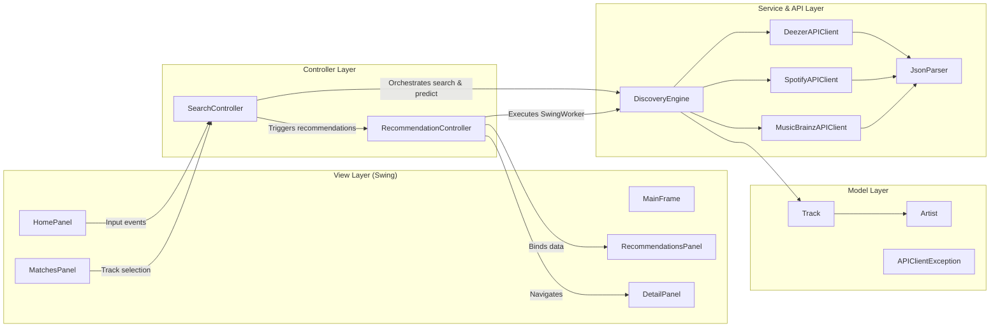

# F5 · MVC Architecture & User Journey Integration

This document formalizes the **Model-View-Controller (MVC)** architectural design implemented in AUDY for the final release, detailing the distribution of layer responsibilities, the integration of user interaction flows, and the conceptual clarification of the term "DB*" (persistence).

---

## 1. Architectural Distribution of Responsibilities

AUDY strictly decouples presentation, orchestration, and business logic into 4 cohesive layers:

### A. Model Layer (`com.audy.models`)
- **`Track`**: Represents the core immutable entity of a musical track (ID, title, artist, genres, 0–100 popularity score, 30s MP3 preview URL, player link, and album artwork). Implements `equals()` and `hashCode()` to enforce strict deduplication by ID and by case-insensitive `(title + artist)`.
- **`Artist`**: Represents a musical creator (ID, name, associated genres).
- **`APIClientException`**: Standardized domain exception encapsulating network status codes, causes, and classifying whether a failure is retryable (`isRetryable`).

### B. View Layer (`com.audy.views`)
- **`MainFrame`**: Primary application container utilizing `CardLayout` to navigate between operational screens (`HOME`, `MATCHES`, `RECS`, `DETAIL`, `LOADING`, `ERROR`).
- **`HomePanel`**: Search interface featuring a floating, non-focus-stealing `JWindow` (`setFocusableWindowState(false)`) that displays live autocomplete suggestions without dropping keystrokes or cursor focus.
- **`MatchesPanel`**: Displays paginated search results triggered by Enter, with smooth vertical scrolling and interactive track cards.
- **`RecommendationsPanel`**: Displays the pinned reference track card alongside the discovered recommendations list, equipped with direct `[Open ↗]` buttons.
- **`DetailPanel`**: Expanded metadata inspector providing live 30-second audio preview playback and a cross-platform web player launcher (`Desktop.browse` with fallbacks to `rundll32` and system clipboard).
- **`UIHelper`**: Centralized style repository managing color palettes, fonts, and component factories.

### C. Controller Layer (`com.audy.controllers`)
- **`SearchController`**: Coordinates `HomePanel` and `MatchesPanel`. Implements a $350\text{ ms}$ client-side debounce timer (`javax.swing.Timer`), manages request sequence tokens to discard stale queries, and dispatches background lookups using `SwingWorker`.
- **`RecommendationController`**: Manages recommendation generation from track selection, triggers the animated loading state, executes `DiscoveryEngine` in a background worker thread, binds data to `RecommendationsPanel`, and routes to `DetailPanel`.

### D. Service & API Layer (`com.audy.services` and `com.audy.api`)
- **`DiscoveryEngine`**: Headless business logic service executing candidate gathering, peer sampling, deduplication, and adaptive popularity bounding.
- **`DeezerAPIClient` / `SpotifyAPIClient` / `MusicBrainzAPIClient`**: Encapsulates Java 11 `HttpClient` REST communication and JSON parsing through `JsonParser.java`.

---

## 2. User Journey Integration

AUDY smoothly supports two user navigation flows:

1. **Path A (Direct Predictive Selection)**:
   - User types at least 2 characters in the search field.
   - After a $350\text{ ms}$ pause, `SearchController` triggers `getPredictiveSuggestions()`.
   - The non-blocking floating window displays 5 suggestions without interrupting typing.
   - User clicks any suggestion $\rightarrow$ `RecommendationController` takes control, displays loading screen, and transitions directly to `RecommendationsPanel`.

2. **Path B (Full Enter Search Matches)**:
   - User types and presses `Enter` (or clicks `Search`).
   - Autocomplete is dismissed, and `SearchController` executes `searchMatches()` (up to 20 tracks).
   - System transitions to `MatchesPanel`. User clicks on any match to launch recommendation generation.

3. **External Discovery & Playback**:
   - In `RecommendationsPanel`, clicking `[Open ↗]` launches the track directly in the user's browser.
   - Clicking the card body navigates to `DetailPanel` to view full metadata and stream the 30-second MP3 preview.

---

## 3. Conceptual Clarification on "DB*" (Persistence)

The course syllabus references "DB*" regarding data persistence. In the context of AUDY's music discovery architecture:

1. **Cloud Data Graphs (Primary Persistence)**:
   AUDY functions as a cloud-native music exploration client. The underlying persistence layer holding tens of millions of tracks, artist relationship graphs, and stream rankings resides within **Deezer**, **Spotify**, and **MusicBrainz**. AUDY queries these cloud graphs in real time.
2. **In-Memory Session Caching**:
   For runtime performance and test suite independence, entities are cached in memory within the controller and service layer.
3. **Justification Against Embedded SQL Databases**:
   Embedding a local SQL engine (like SQLite or H2) with static tables would have required pre-populating a local database, which **directly violates the project's core requirement of "zero hardcoded knowledge"** and dynamic global discovery.
