# F6 · Final UML Class Diagram & Architectural Evolution

This document presents the **Final UML Class Diagram** for AUDY according to the completed final release implementation and details the **three-sprint architectural evolution** of the system in **technical English**.

---

## 1. Complete Final UML Class Diagram

```mermaid
classDiagram
    %% Model Layer
    class Track {
        - String id
        - String title
        - Artist artist
        - List~String~ genres
        - int popularity
        - String previewUrl
        - String playerUrl
        - String coverImage
        + getId() String
        + getTitle() String
        + getArtist() Artist
        + getGenres() List~String~
        + getPopularity() int
        + getPreviewUrl() String
        + getPlayerUrl() String
        + getCoverImage() String
        + equals(Object o) boolean
        + hashCode() int
    }

    class Artist {
        - String id
        - String name
        - List~String~ genres
        + getId() String
        + getName() String
        + getGenres() List~String~
    }

    class APIClientException {
        - boolean retryable
        + isRetryable() boolean
    }

    %% Service & API Layer
    class DeezerAPIClient {
        - HttpClient httpClient
        - String API_BASE_URL
        + searchTracks(String query, int limit) List~Track~
        + resolveArtistId(String artistName) String
        + getRelatedArtists(String artistId) List~Artist~
        + getArtistTopTracks(String artistId, int limit) List~Track~
    }

    class SpotifyAPIClient {
        - String clientId
        - String clientSecret
        - String accessToken
        + authenticate() void
        + searchTracks(String query, int limit, int offset) List~Track~
        + getTrackMetadata(String trackId) Track
        + getArtistMetadata(String artistId) Artist
    }

    class MusicBrainzAPIClient {
        - String userAgent
        + fetchTrackTags(String trackTitle, String artistName) List~String~
    }

    class DiscoveryEngine {
        - DeezerAPIClient deezerApi
        - SpotifyAPIClient spotifyApi
        - MusicBrainzAPIClient musicBrainzApi
        - long lastKeystrokeTimestamp
        - long DEBOUNCE_DELAY_MS
        - int MIN_RECOMMENDATIONS
        + getPredictiveSuggestions(String partialText) List~Track~
        + searchMatches(String query) List~Track~
        + generateRecommendations(Track referenceTrack) List~Track~
    }

    class JsonParser {
        + parseObject(String json) Map~String, Object~
        + parseArray(String json) List~Object~
        + getString(Map map, String key) String
        + getInt(Map map, String key, int def) int
        + getObject(Map map, String key) Map
        + getArray(Map map, String key) List
    }

    %% View Layer
    class MainFrame {
        - CardLayout cardLayout
        - JPanel mainContainer
        - HomePanel homePanel
        - MatchesPanel matchesPanel
        - RecommendationsPanel recsPanel
        - DetailPanel detailPanel
        + showScreen(String name) void
        + showLoading(String message) void
        + showError(String msg, Runnable onRetry) void
        + showMatches(List~Track~ tracks, String query) void
        + showRecommendations(Track ref, List~Track~ recs) void
        + showDetail(Track track) void
    }

    class HomePanel {
        - JTextField searchField
        - JWindow predictWindow
        + setOnSearch(Consumer handler) void
        + setOnPredictiveSearch(Consumer handler) void
        + setOnTrackSelected(Consumer handler) void
        + showPredictions(List~Track~ tracks) void
        + hidePredictions() void
    }

    class MatchesPanel {
        + setData(List~Track~ matches, String query) void
        + setOnTrackSelected(Consumer handler) void
        + setOnBackHome(Runnable handler) void
    }

    class RecommendationsPanel {
        + setData(Track reference, List~Track~ recommendations) void
        + setOnTrackSelected(Consumer handler) void
        + setOnBackHome(Runnable handler) void
    }

    class DetailPanel {
        + setTrack(Track track) void
        + setOnBack(Runnable handler) void
        + setOnBackHome(Runnable handler) void
        + openBrowserUrl(Component parent, String url)$ void
    }

    class UIHelper {
        + BG_PRIMARY Color
        + ACCENT Color
        + createButton(String text, Color bg, Color fg)$ JButton
        + createLabel(String text, Font font, Color fg)$ JLabel
    }

    %% Controller Layer
    class SearchController {
        - MainFrame mainFrame
        - DiscoveryEngine engine
        - RecommendationController recoController
        - Timer debounceTimer
        - int currentPredictSeq
    }

    class RecommendationController {
        - MainFrame mainFrame
        - DiscoveryEngine engine
        + generateRecommendations(Track referenceTrack) void
    }

    %% Relationships
    Track --> Artist : contains
    DiscoveryEngine --> DeezerAPIClient : uses
    DiscoveryEngine --> SpotifyAPIClient : uses
    DiscoveryEngine --> MusicBrainzAPIClient : uses
    DeezerAPIClient ..> APIClientException : throws
    SpotifyAPIClient ..> APIClientException : throws
    MusicBrainzAPIClient ..> APIClientException : throws
    DeezerAPIClient ..> JsonParser : uses
    SpotifyAPIClient ..> JsonParser : uses

    SearchController --> MainFrame : manages
    SearchController --> DiscoveryEngine : delegates
    SearchController --> RecommendationController : navigates
    RecommendationController --> MainFrame : manages
    RecommendationController --> DiscoveryEngine : delegates

    MainFrame *-- HomePanel
    MainFrame *-- MatchesPanel
    MainFrame *-- RecommendationsPanel
    MainFrame *-- DetailPanel
    HomePanel ..> UIHelper
    MatchesPanel ..> UIHelper
    RecommendationsPanel ..> UIHelper
    DetailPanel ..> UIHelper
```

---

## 2. Design Evolution Across the Three Deliveries

| Architectural Dimension | Delivery 1 (Initial Prototype) | Delivery 2 (Intermediate) | Delivery 3 (Final Release) |
|---|---|---|---|
| **System Architecture** | Basic entity classes (`Track`, `Artist`). No real network clients or graphical interface. | Enhanced models and modular API clients (`SpotifyAPIClient`, `MusicBrainzAPIClient`). UI remained unimplemented (*"Pending UI"*). | **Full MVC Architecture**: 4 decoupled layers (Models, Swing Views, Controllers, Services) and 3 modular API clients. |
| **Presentation Layer** | None (conceptual console output). | None (iPad sketches and static Figma mockups only). | **Desktop Swing GUI**: Reactive screens with `CardLayout`, non-focus-stealing floating `JWindow`, and animated transitions. |
| **Recommendation Engine** | Hypothetical / stub logic. | Basic keyword searches and preliminary static filters. | **100% Dynamic Deezer Graph**: Cloud collaborative filtering, randomized peer sampling, and adaptive popularity bounding. |
| **API Connectivity** | None. | Spotify and MusicBrainz. Blocked by dev quota limits and deprecated endpoints. | **Deezer API (Primary)** + Spotify (Secondary) + MusicBrainz (Tag Enrichment) with zero mandatory API keys. |
| **Verification & Quality** | Inexistent. | Scattered ad-hoc manual tests. | **37 Automated Unit Tests** (`RequirementsVerification`) executing in $< 250\text{ ms}$ with 100% passing rate. |

---

## 3. Technical Evolution Justification

The evolution of AUDY across the semester exemplifies progressive refinement in object-oriented software engineering:

1. **Decoupling and High Cohesion (Deliveries 1 to 2)**:
   The early architecture coupled data representation with ad-hoc business operations. Delivery 2 introduced the **Single Responsibility Principle (SRP)** by isolating external network logic into dedicated API clients (`SpotifyAPIClient`, `MusicBrainzAPIClient`) and wrapping domain errors into an explicit checked exception (`APIClientException`).

2. **Transition to Full MVC Architecture (Deliveries 2 to 3)**:
   Delivery 2 left the presentation layer as an unfulfilled requirement (*"Pending UI"*). In Delivery 3, the entire system was restructured under the **Model-View-Controller (MVC)** architectural pattern:
   - **Views** are passive, self-rendering Swing components decoupled from business rules.
   - **Controllers** act as the coordination mediator, orchestrating background worker threads (`SwingWorker`) so that heavy network I/O never blocks the Java AWT Event Dispatch Thread (EDT).
   - **Services** (`DiscoveryEngine`) remain headless and independently testable without instantiating any UI widgets.

3. **Resilience to Vendor Limitations (The Deezer Pivot)**:
   When external platform constraints (Spotify's restriction of developer mode recommendations and elimination of search popularity) threatened the core functionality of the system, the architecture proved its compliance with the **Open-Closed Principle (OCP)**. By introducing `DeezerAPIClient`, the team substituted the underlying discovery mechanism without rewriting the controllers or data models, preserving the existing contracts of the system while achieving zero-friction deployment.
