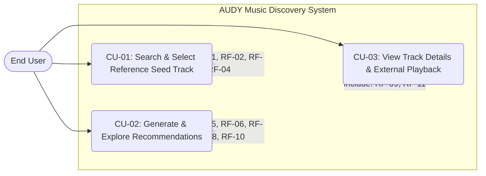

# F7 · Consolidated Use Cases & Acceptance Criteria

This document details the consolidated specification of **AUDY's Use Cases** for the final release, updated to reflect the operational MVC implementation and mapped directly to their corresponding **Functional Requirements (RF)**.

> **Note on Task F7.1**: The existing PDF documentation and use case diagram artifacts (`docs/casos-de-uso/AUDY-casos-de-uso.png` and `docs/requirements/`) have been verified and are completely readable with no corruption or rendering defects.

---

## 1. General Use Case Diagram

---

## 2. Detailed Use Case Specifications

### CU-01 · Search and Select Reference Seed Track
- **Primary Actor**: End User.
- **Related Requirements**: **RF-01**, **RF-02**, **RF-03**, **RF-04**, **RNF-04**.
- **Preconditions**: AUDY is launched and displaying `HomePanel`. Active Internet connection.
- **Main Success Scenario (Predictive Dropdown Flow)**:
  1. The user begins typing in the search bar (e.g., *"Nirvana"* or *"Tarot"*).
  2. After a $350\text{ ms}$ pause, the system queries the API and displays up to 5 matching suggestions in a non-blocking floating window without losing keyboard focus.
  3. The user clicks on a suggested track.
  4. The system registers the selected track as the reference seed and transitions immediately to **CU-02**.
- **Alternative Flow A (Full Search on Enter)**:
  - At step 2, the user presses `Enter` or clicks the `Search` button.
  - The system dismisses any open autocomplete popup, displays the loading state, and executes full search.
  - The system transitions to `MatchesPanel` displaying up to 20 matching songs.
  - The user clicks on any song $\rightarrow$ it is registered as the seed and triggers **CU-02**.
- **Exception Flows**:
  - *No autocomplete matches*: Displays "No matches found" inside the dropdown menu.
  - *No search matches on Enter*: Displays empty state in `MatchesPanel` with a button to return to Home (**RF-10**).
  - *Network failure*: Displays a non-fatal warning inside the dropdown or a reusable error screen with a "Retry" option (**RF-11**).

---

### CU-02 · Generate and Explore Recommendations
- **Primary Actor**: End User.
- **Related Requirements**: **RF-05**, **RF-06**, **RF-07**, **RF-08**, **RF-10**, **RNF-01**, **RNF-03**.
- **Preconditions**: A valid reference seed track has been designated.
- **Main Success Scenario**:
  1. The system displays the animated loading screen indicating that recommendations are being gathered.
  2. `RecommendationController` executes `DiscoveryEngine` in a background worker thread (`SwingWorker`).
  3. The engine dynamically queries Deezer's collaborative filtering graph (`/artist/{id}/related`) to retrieve related peers and their top tracks.
  4. The engine filters out the reference track and eliminates duplicates (**RNF-03**).
  5. The engine applies adaptive popularity filtering based on the seed's popularity (**RF-07**).
  6. The system transitions to `RecommendationsPanel`, pinning the reference seed card at the top and presenting at least 10 dynamically discovered tracks with title, artist, popularity, and direct `[Open ↗]` buttons.
- **Exception Flows**:
  - *Fewer than 10 tracks after strict filtering*: The engine automatically relaxes bounds to include secondary candidates from the same peer pool to satisfy the 10-track guarantee (**RNF-03**).
  - *Network timeout*: Encapsulates `APIClientException` and presents the reusable error screen with "Retry" (**RF-11**).

---

### CU-03 · View Track Details and External Playback
- **Primary Actor**: End User.
- **Related Requirements**: **RF-09**, **RF-11**.
- **Preconditions**: `RecommendationsPanel` is active with at least one discovered track.
- **Main Success Scenario (Full Detail Inspection)**:
  1. The user clicks on a recommendation card.
  2. The system navigates to `DetailPanel`, displaying title, artist, authentic 0–100 popularity score, metadata provider, and action controls.
  3. The user clicks "Open on Deezer ↗" (or Spotify) $\rightarrow$ the system launches the default operating system browser to the official track page.
  4. The user clicks "Play Preview ▶" $\rightarrow$ the system launches/streams the official 30-second MP3 preview audio.
  5. The user can navigate back to recommendations via "← Back" or reset to the search screen via "Home".
- **Alternative Flow (Direct Open)**:
  - On the recommendation card, the user clicks the embedded `[Open ↗]` button $\rightarrow$ the system launches the browser immediately without opening the detail view.
- **Exception Flow**:
  - *Browser execution blocked by OS*: The system automatically copies the full track URL to the clipboard and presents an informational dialog allowing the user to paste it (**RF-11**).
